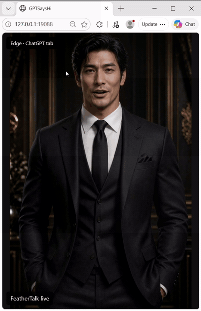
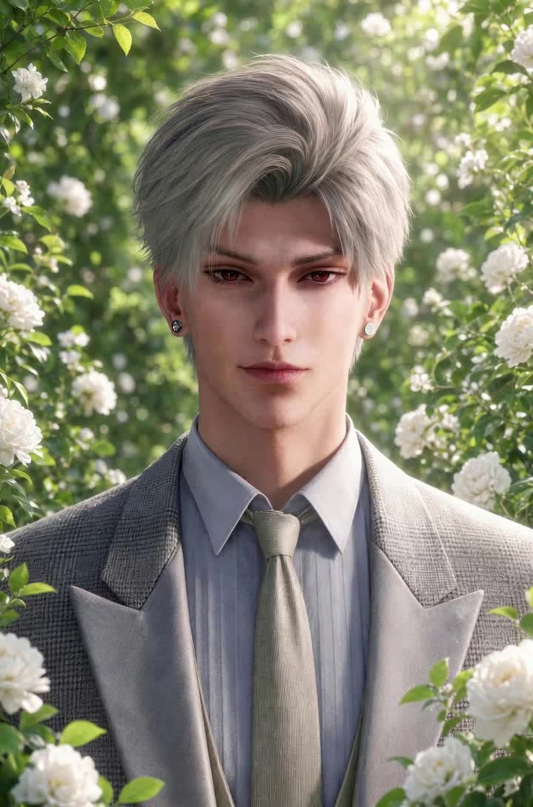

# GPTSaysHi

A Windows spin-off of SpecterSaysHi that captures audio from ChatGPT Live, ChatGPT Classic, Edge, or Chrome to drive a digital avatar. Optimized for ultra-low first-frame latency and natural lip sync. SpecterSaysHi的衍生项目，在Windows系统上把chatgpt live输出的声音直接接入程序驱动数字人嘴巴动。监听Chatgpt/Chatgpt classic/浏览器（当前支持Edge/Chrome）；工作量体现在极致压缩首帧输出延迟和调教视频令其natural上。

注意一下哈，其实针对做模型本身而言，虽然理论上来说都能按照一个 workflow 走通，但每个模型在做的时候，训练出来的结果在工程上的调优仍然需要单独做。

世界上没有两片一样的叶子，实际上也没有两个一样的模型。而且它又是一个非常基于人眼的东西，AI 真的看不了：AI 不会觉得一张脸上面脸黑、下面脸白是有什么问题的，但人一眼就能看出来这绝对不是一个好的 avatar。

反正就是这么一个意思：不要觉得这是一个 fixed workflow，到最后一步去做优化的时候，仍然挺依靠人的主观判断。

## Demo

[](https://github.com/YeChen-coder/GPTSaysHi/releases/download/v0.1.0/gptsayshi-edge-live-demo.mp4)

ChatGPT Live audio from an Edge tab drives the avatar in real time.
Click the animated preview to open the **50-second edited demo with audio**.
The preview shows an 8-second excerpt and has no sound.

[Watch or download the full demo](https://github.com/YeChen-coder/GPTSaysHi/releases/download/v0.1.0/gptsayshi-edge-live-demo.mp4).

## What runs locally



GPTSaysHi connects the playback audio from a normal ChatGPT Live conversation
to a FeatherTalk avatar. Use the ChatGPT desktop app, ChatGPT Classic, or one
selected ChatGPT tab in Edge or Chrome. The newest connection replaces the
previous source; the previous source stops instead of reconnecting to take over.

This is a standalone project. No SpecterSaysHi checkout, prebuilt Specter image,
OpenAI API key, or API session is required. ChatGPT still handles the conversation,
account and voice allowance. GPTSaysHi does not start the Live call for you.

The default avatar is the **October 17 approved QinChe**: a clean epoch-100
model, the selected natural-listening take 1 and **NativeFaceMatch** mouth-local
composition. Its 251 unique native frames map to a 500-frame, 20-second
forward/reverse timeline at 25 fps. Native nose, cheek and chin texture stays
intact; the new profile uses no donor teeth, chin-cache overlay or sharpening.

The original **gentleman** keeps its October 4 checkpoint, 500-frame idle,
same-character teeth restoration, matched chin cache and 400 ms settling.
These are separate rendering profiles. QinChe returns directly to its native
idle as in the approved comparison, with no additional server settling frames
or viewer crossfade. Speech audio always advances forward for both characters.
The earlier October 12 QinChe bundle is retired and is no longer selectable.

## Select a character

Create `.env` in this project's directory (or copy `.env.example`) and set:

```dotenv
GPTSAYSHI_CHARACTER=QinChe
```

Use `GPTSAYSHI_CHARACTER=gentleman` to switch back to the original avatar.
Run `.\start_avatar.ps1` after changing the selection, then refresh
**http://127.0.0.1:19088/**. Restarting recreates the service and loads only the
selected visual model. Refreshing the page alone does not switch the character.
Without a setting, QinChe is selected. A PowerShell environment variable takes
precedence over `.env`; remove that override before changing `.env`.

Startup installs and verifies only the selected character's resources.
The other character's files remain on disk and are not loaded. ChatGPT app,
Classic, Edge and Chrome audio capture work with either character.

The demo above shows the original gentleman avatar.

## Requirements

- Windows 11 with the normal ChatGPT app or a current Edge/Chrome browser.
- Python 3.11 or newer on `PATH`.
- Docker Desktop with Linux containers, WSL 2 and NVIDIA GPU support.
- An NVIDIA GPU with sufficient available memory. This version uses CUDA 12.1
  and was tested on a 12 GB GPU alongside other local services.
- About 679 MB for QinChe's extracted assets, or 1.4 GB for gentleman,
  plus the Docker image and Python environment. Keeping both uses about 2 GB.

The Windows capture helper compiles with the .NET Framework compiler already
included with Windows. No audio driver installation is needed.

## First setup

Clone the repository, then run these commands in PowerShell:

You can also download [**gptsayshi-windows-v0.3.0.zip**](https://github.com/YeChen-coder/GPTSaysHi/releases/tag/v0.3.0) and extract
the `GPTSaysHi` folder. It includes the compiled Windows capture helper. The
`Start ChatGPT.cmd`, `Start Classic.cmd`, `Start Browser.cmd`, and
`Stop GPTSaysHi.cmd` shortcuts call the same scripts below. Python and Docker
Desktop are still required; the first start downloads the avatar assets.

```powershell
git clone https://github.com/YeChen-coder/GPTSaysHi.git
cd GPTSaysHi
.\setup.ps1
```

Setup creates a private `.venv`, installs the audio bridge dependency, compiles
the native audio helper and downloads the hash-pinned avatar resource archive
from this repository's [v0.3.0 release](https://github.com/YeChen-coder/GPTSaysHi/releases/tag/v0.3.0)
for QinChe. Gentleman keeps its existing v0.1.0 asset archive. Large models and
runtime media stay outside Git history; each character's manifest verifies every
installed file. QinChe's download is about 516 MB and expands to about 679 MB.

For an offline installation, download the archive separately and run:

```powershell
python .\assets.py --character QinChe --archive C:\Downloads\gptsayshi-qinche-approved-20261017.zip
.\setup.ps1
```

If PowerShell blocks local scripts, follow your Windows script policy or run the
individual commands shown in the scripts. The project does not change system
execution policy.

## ChatGPT app or Classic

To add two launchers to your Windows desktop, run `./install_desktop.ps1`.
**GPTSaysHi-Start.cmd** starts the selected avatar and opens its preview;
**GPTSaysHi-Stop.cmd** stops GPTSaysHi's container and owned capture processes.
Both use the fixed `gptsayshi` Docker project on port 19088, independently of
SpecterSaysHi. Audio still connects through the app command or browser extension
described below. Run the installer again if you move the project directory.

Open the relevant app and manually start a normal Live conversation. Then run:

```powershell
# ChatGPT desktop app
.\start.ps1

# ChatGPT Classic
.\start.ps1 -App classic
```

Open **http://127.0.0.1:19088/** to see the avatar. App capture defaults to
30 minutes and does not save audio. Use Ctrl+C to stop the current capture.
Optional recording requires an explicit `-RecordAudio` argument; those recordings
stay in the ignored local `results/` directory.

## Edge or Chrome

Start the avatar service:

```powershell
.\start_avatar.ps1
```

Load the same extension in either browser:

1. Open `edge://extensions/` or `chrome://extensions/`.
2. Enable Developer mode, choose **Load unpacked**, and select this repository's
   `browser_extension` folder. Pin **GPTSaysHi · ChatGPT Live** to the toolbar.
3. In the desired ChatGPT tab, start a Live conversation. Open the extension
   and click **Connect this ChatGPT tab**.

Only the selected HTTPS `chatgpt.com` or `chat.openai.com` tab is allowed.
Other tabs and system audio are excluded. Refreshing the selected page, leaving
ChatGPT or closing the tab stops capture. Clicking Connect in another ChatGPT
tab explicitly switches the source. Closing the popup or focusing another tab
does not switch it.

The capture contains all playback audio in the selected ChatGPT tab, including
read-aloud audio or notifications in that same tab. It does not inspect the
conversation or identify which allowance the account is consuming. Browser
capture restores the tab's normal audible output once after `tabCapture` diverts it.

## Switching and stopping

The last successful explicit connection wins. A new app, Classic or browser
connection closes the previous connection with code `4001`, waits for renderer
cleanup and becomes the current input. Old inputs stop and do not automatically
fight to reconnect. Re-run the desired app command or click the extension's
Connect button to switch back. A newly connected but silent source remains selected.

```powershell
.\stop.ps1
```

This stops only GPTSaysHi's container and its own native capture helper.
Port `19088` must be free. Stop the earlier ChatGPTVoiceAvatarLab service before
running the standalone version on the same computer.

## Timing and limits

Audio is copied after ChatGPT plays it, then sent in 100 ms packets as 24 kHz
mono PCM16. The bridge retains 200 ms of leading audio and two trailing packets.
Inference uses bounded history and the fast mode without audio lookahead.
The bridge sends each generated frame immediately, including final audio
flushes through a two-frame bounded worker queue. GPU reference caching,
streaming warmup, CPU thread limits and bounded history/queues apply to both
characters. Appearance and return-to-idle behavior are selected per character.
The continuous resampler retains about 1.33 ms of input for its FIR filter;
fast mode adds no future-feature waiting. See the
[engineering audit and measured comparison](docs/ENGINEERING.md).
ChatGPT playback and avatar display do not share a synchronized playback clock;
end-to-end lip-sync latency has not been measured precisely.

Desktop capture covers the selected app's process tree. If the app hosts several
audio activities in the same tree, those outputs cannot be separated by this
capture method. Browser capture has the narrower selected-tab boundary.

## Development and verification

```powershell
python -m unittest discover -s tests -p "test_*.py"
python .\assets.py --verify
docker compose build
```

GPU/Windows integration checks require the running avatar and the native helper:

```powershell
.\.venv\Scripts\python.exe .\tests\integration_sources.py
npm ci
node .\tests\integration_extension.cjs edge
node .\tests\integration_extension.cjs chrome
```

Browser integration checks use isolated, unsigned-in profiles and local fixtures,
not the user's browsing profile or a real ChatGPT call. See
[validation notes](docs/VALIDATION.md) and [third-party notices](THIRD_PARTY_NOTICES.md).

The compositor's four CPU image checks require NumPy/OpenCV (already in the
avatar image). The remaining distribution checks also run in the host bridge
environment. Optional viewer/long-stream checks are:

```powershell
node .\tests\integration_avatar.cjs
python .\tests\integration_long_stream.py
```

## Project layout

```text
browser_extension/    Edge and Chrome selected-tab audio bridge
runtime/              WebSocket avatar service, streaming and transitions
engine/               Moving-base FeatherTalk rendering and idle matching
vendor/feathertalk/    Required upstream runtime code and its original license
assets/               Downloaded models and avatar data (ignored by Git)
characters.json       Character mapping and selected release identities
.env.example          GPTSAYSHI_CHARACTER selection example
assets-manifest*.json Per-character resource hashes
asset-bundle*.json    Per-character pinned release archive metadata
ProcessAudio.cs       Windows process-tree loopback capture
bridge.py             Desktop audio forwarding and source replacement
```

# 开发日志和各种吐槽

诶呀，好气啊，

我自己测了一下。原来看效果图我觉得还行，自己测完发现不行：秦彻现在这一版嘴非常糊。问了怎么回事，说是因为他训出来的这一版，本来 FastTalk 模型的输出是 144×144，但秦彻这一版这边得给放大成 300 多乘 300 多像素，这么一糊根本搞不了。

又得回去看这到底是怎么回事、怎么训练的能训成这样。之前那版我觉得还挺好的，gentleman 那边预测的是 158×158，清晰度就没像现在这么差。

补充一下，这件事情我也有责任。

是这样的，Codex 的意思是说，首先 FeatherTalk 这个用来训练的模型，本来要求的尺寸就是 144×144，那边是固定的。可是我这两张底图人物原图的嘴部(这边讲确切一点，其实是待机视频的人物嘴巴。可是你这个待机视频，它其实也是根据这个底图来生成的，所以其实它们两个讲的是一个意思)不是这个尺寸：

• 绅士那边还好，本来脸占图像的比例就小，大概也就 158×158 左右，所以输出结果是好的。

• 秦彻这一版因为脸占得比较大，嘴部自然也占得大，达到了 358×358。

这样一来，模型输出的尺寸本来只有 144×144，直接放大两倍确实就会出问题。

对不起啊，这个方面确实是我之前没有考虑到，是我的问题。我再找办法改进，反正这个肯定能改好

既然谈到这儿了，就顺手把它的整个流程摸清楚吧。先不谈大了，我们仍然先聚焦在具体问题上：首先是进来的这两个 avatar，它们的原图尺寸其实是一样的，毕竟都是 Grok 生成的，原图尺寸都是这个规格 1152×1728。

但整张图片尺寸相同，不代表人物的脸在图片里一样大。同样大小的照片，可以拍全身，也可以拍近景。
后续生成、选定的素材也经历了变化。实际对比是：

| 项目 | Gentleman | QinChe |
|---|---:|---:|
| 待机视频整幅尺寸 | 720×1094 | 720×1088 |
| 下半脸裁切框的典型尺寸 | 约155～158 | 约253 |
| 实际用于模型训练的图块 | 144×144 | 144×144 |

两个视频整体尺寸差别很小，下半脸尺寸差距主要来自人物构图和脸的占比。
训练时，我没有把整张视频画面直接塞进模型。两个人物都是：
读取原始视频帧 → 定位下半脸 → 裁出区域 → 缩放到152×152 → 取中央144×144作为训练图。
所以不同原图、不同视频尺寸都被统一了。但是代价也明确：秦彻原本较大的脸部区域，同样被压到144像素学习；生成后贴回较大区域，清晰度差距就更明显。

这是一个分析对比图：


